# Opa, tudo bom? 👋 | Hey, what's up? 👋

###  Português

**Desenvolvedor Trainee** e estudante de **Sistemas para Internet** (6º e último semestre) na **Fatec São Roque** (2024–2026).

Em 2026 eu me formarei como Tecnólogo em Sistemas para Internet na Fatec São Roque. Possuo inglês avançado e em breve irei buscar aprender novos idiomas, tais como francês, japonês, chinês, italiano e, quem sabe, espanhol.

Em relação às minhas relações interpessoais, acredito que me dou muito bem com todo mundo, dentro e fora do ambiente de trabalho. Gosto de trabalhar em equipe, ajudando uns aos outros.

Na área de TI, sei fazer manutenção de hardware, utilizar bem o pacote Office e usar o Figma para prototipagem. Também sei fazer edição de vídeo (Premiere/Vegas) e gosto de dizer que sei utilizar até que bem o Photoshop.

📍 São Roque – SP, Brasil
💼 Atuando na **Prezensa**
🔗 [LinkedIn](https://www.linkedin.com/in/amauri-carlos/)

###  English

**Trainee Developer** and **Internet Systems** student (6th and final semester) at **Fatec São Roque** (2024–2026).

In 2026, I will graduate with an Associate Degree in Internet Systems from Fatec São Roque. I have advanced English and plan to learn new languages soon, such as French, Japanese, Chinese, Italian, and maybe Spanish.

As for interpersonal skills, I believe I get along well with everyone, both inside and outside the workplace. I enjoy teamwork and helping one another.

In IT, I can perform hardware maintenance, I'm proficient with the Microsoft Office suite, and I use Figma for prototyping. I can also edit videos (Premiere/Vegas), and I like to say I'm pretty good with Photoshop.

📍 São Roque – SP, Brazil
💼 Working at **Prezensa**
🔗 [LinkedIn](https://www.linkedin.com/in/amauri-carlos/)

---

## 🛠️ Tecnologias | Tech Stack

**Linguagens | Languages**

       
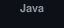  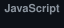 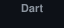 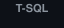 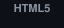 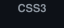

**Frameworks e plataformas | Frameworks & Platforms**

   
  

**Banco de dados | Database**

  
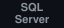 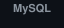

**Ferramentas | Tools**

    
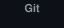 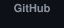 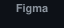 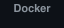

**Outros conhecimentos | Other Skills**

  
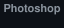 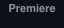

---

## 🎯 Foco atual | Current Focus

- Concluir o TCC (GDA) e a graduação na Fatec São Roque
- Evoluir como desenvolvedor trainee, com foco em back-end e arquitetura de software

- Finish my capstone project (GDA) and my degree at Fatec São Roque
- Grow as a trainee developer, focusing on back-end and software architecture

---

## 📫 Contato | Contact

 Vamos conversar? Me chame no [LinkedIn](https://www.linkedin.com/in/amauri-carlos/).

 Let's talk! Reach out on [LinkedIn](https://www.linkedin.com/in/amauri-carlos/).
